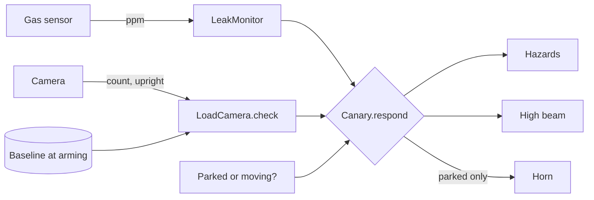

# IAA LCV BYOD Hackathon 2026

Code from the IAA Transportation LCV Bring-Your-Own-Device hackathon, run by
digital.auto and prototype.club. The brief asked teams to connect external
devices to software-defined light commercial vehicles, using a camera as the
first reference device. The full brief is in
[`docs/HACKATHON_BRIEF.md`](docs/HACKATHON_BRIEF.md).

All three apps run on the digital.auto SDV runtime against the vehicle model
`IAA Hannover Hackathon 2026`.

| Prototype | What it does | Entry point |
|---|---|---|
| [Canary Go](prototypes/canary-go/) | Portable load bay monitor for vans carrying LPG. A gas sensor catches leaks and a camera catches cylinders that shift or fall. The van answers with hazards, high beam and horn, and skips the horn while moving. This was the pitched entry. | `app/main.py` (stdlib only) |
| [Camera pipeline](prototypes/camera-pipeline/) | General camera-to-vehicle loop: MJPEG frames, a pluggable detector, a rolling-window rule, then a vehicle alert and an evidence upload. | `app/main.py` + modules |
| [Device permissions](prototypes/device-permissions/) | Onboarding for unknown devices. A device declares what it wants, an operator grants a narrower, expiring set of Kuksa-style scopes, and every write is checked and audited. | `app/main.py` (stdlib only) |

## Diagrams

- [`docs/ARCHITECTURE.md`](docs/ARCHITECTURE.md) has class, state and sequence
  diagrams for all three prototypes. GitHub renders the Mermaid blocks inline.
- [`docs/visualization.html`](docs/visualization.html) is an interactive page
  with a signal trace of the Canary Go demo (gas, camera, hazards, high beam,
  horn) and class diagrams for all three prototypes. You can replay the run, or
  switch on "van is moving" or "sensor drops readings" and see the response change. Open it locally, or enable GitHub Pages on `/docs` and visit
  `https://<user>.github.io/<repo>/visualization.html`.



## Running on the Playground

1. Open the [digital.auto Playground](https://playground.digital.auto/) and pick
   the model `IAA Hannover Hackathon 2026`.
2. Create a multi-files prototype and copy in the prototype's `app/main.py` and
   `app/requirements.txt` (plus the other modules for the camera pipeline).
3. Open the terminal panel, add your runtime (`Runtime-<name>`), and run.

[`prototypes/canary-go/HANDOVER.md`](prototypes/canary-go/HANDOVER.md) covers
the dashboard widgets, going live with real sensors, and the pitch script.

## Running the tests locally

The tests replace the runtime-only modules (`vehicle`, `sdv`,
`velocitas_sdk`) with fakes, so they run on any Python 3.9+.

```bash
python3 prototypes/canary-go/tests/test_canary.py
```

```bash
python3 prototypes/device-permissions/tests/test_permissions.py
```

```bash
pip install requests==2.32.3 && python3 prototypes/camera-pipeline/tests/test_loop.py
```

CI runs all three on every push (`.github/workflows/tests.yml`).

## Repository layout

```
docs/
  ARCHITECTURE.md        diagrams for all three prototypes
  visualization.html     interactive diagrams and leak monitor simulation
  HACKATHON_BRIEF.md     the organisers' brief
  brief-images/          Playground setup screenshots from the brief
  pitch/                 topic pitch deck
prototypes/
  canary-go/             app/, tests/, HANDOVER.md
  camera-pipeline/       app/, tests/, README.md
  device-permissions/    app/, tests/
```

## Changes since the hackathon

Canary Go:

- `SimulatedLoadCamera` and `LiveLoadCamera` now share a `LoadCamera` base
  class. The two copies of `check()` became one, and the base class gives
  `script()` a no-op default. Before this, switching to the live camera would
  have crashed the demo at its first `script()` call.
- `arm()` no longer crashes when the live camera has not understood a frame
  yet. It arms against an empty baseline and `check()` holds until it can see.
- The live MJPEG reader appends to a `bytearray` and trims it in place. The old
  `bytes +=` copied the whole buffer on every 4 KB chunk.
- The demo resets the camera through `script()` instead of setting its
  `upright` attribute directly.
- The demo no longer crashes when the gas sensor returns no reading. A live
  `HttpGasSensor` returns `None` on a network error, and the event loops called
  `int(None)` on it. The table now shows `---` for that sample.
- New test suite: 23 tests covering the leak monitor hysteresis, both cameras,
  the vehicle responses, and a full demo run that has to finish with every
  actuator off.

Device permissions: new 7-test suite for scope parsing, narrowed grants,
revocation and the audit log.

Camera pipeline: unchanged. Its 42 existing tests pass.

None of these changes touch the runtime constraints in the handover: the `sdv`
import fallback, literal `Vehicle.*` attribute chains, `print(flush=True)`
output, and an empty `requirements.txt` for Canary Go.

## Status

Canary Go runs end to end with **simulated** devices. It prints SIMULATED at
startup and never presents simulated readings as live. `HttpGasSensor` and
`LiveLoadCamera` are written but were not tested against real hardware.

The ngrok camera URLs in the code were the organisers' temporary hackathon
endpoints and may no longer respond.

## License

Apache 2.0, see [LICENSE](LICENSE).
