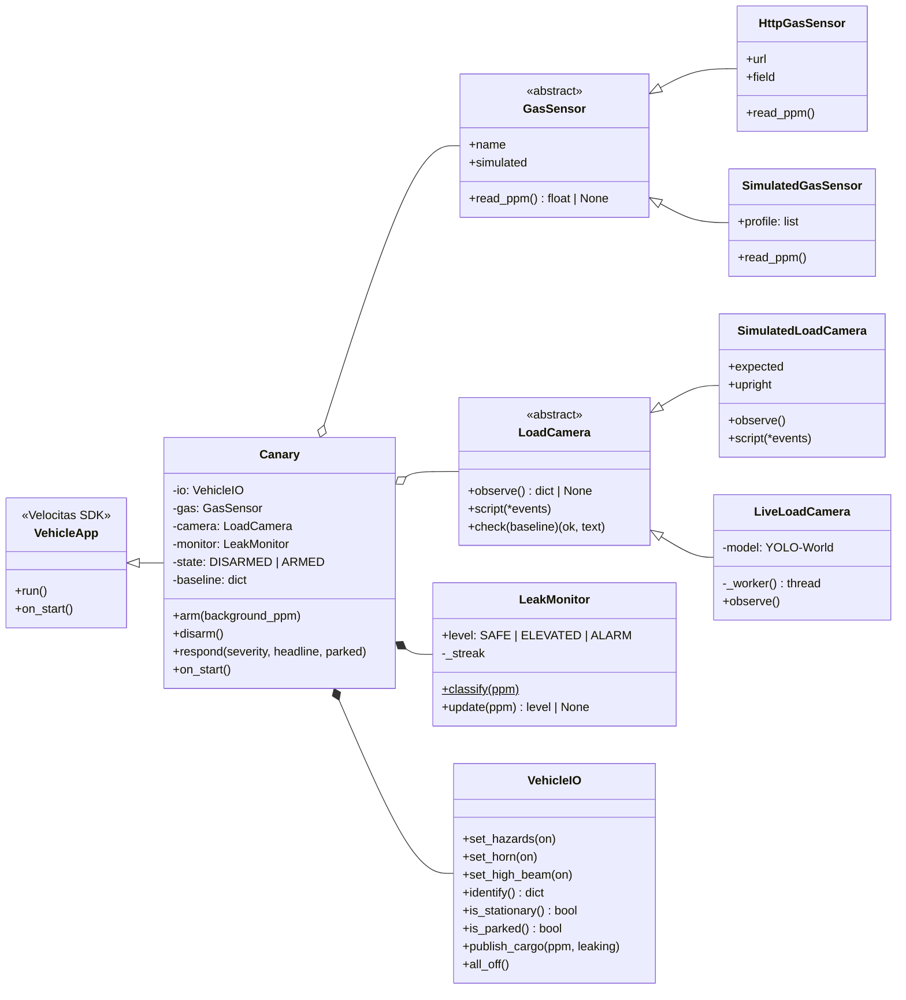
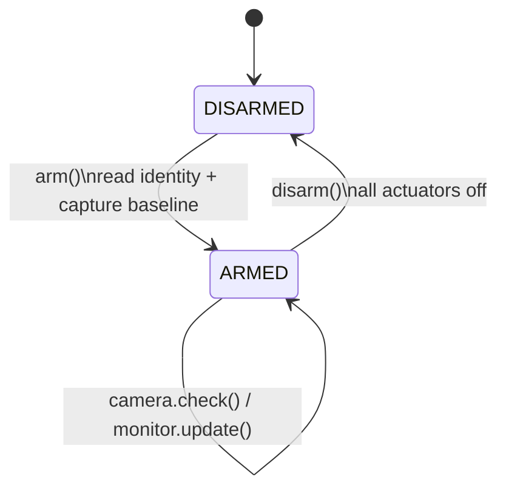
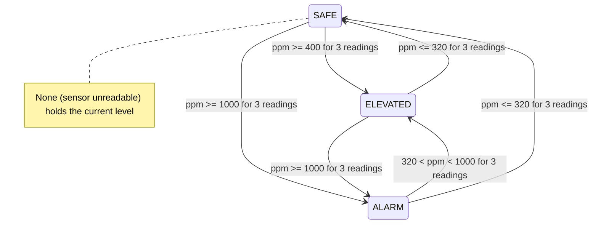
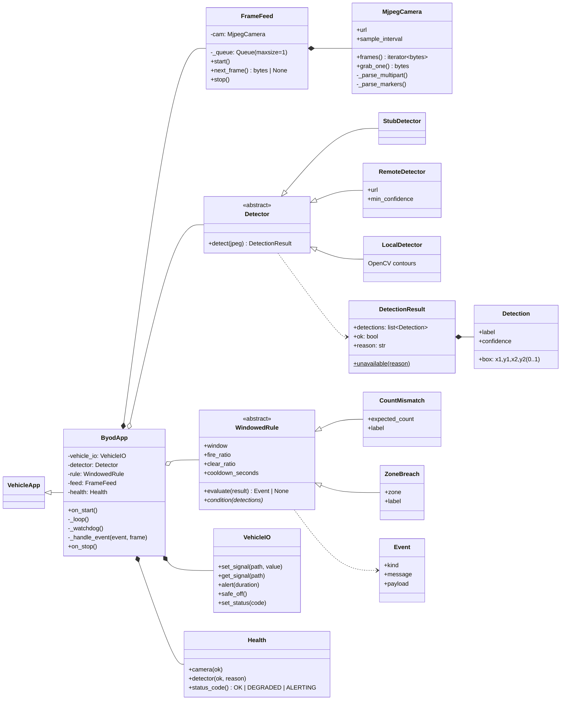
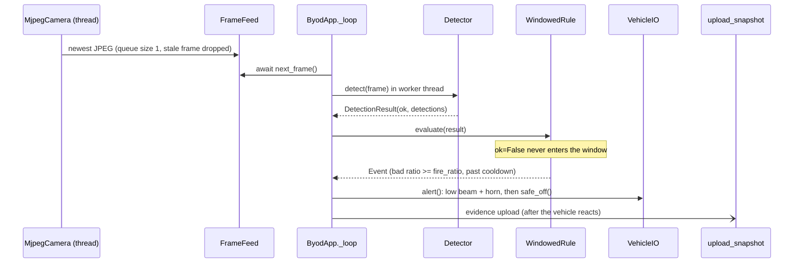
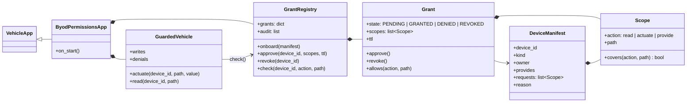
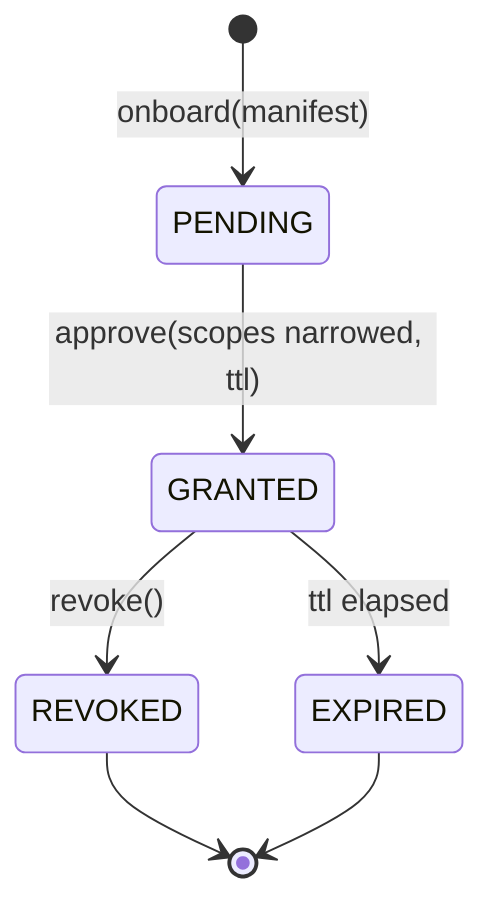

# Architecture

All three prototypes run as a Velocitas `VehicleApp` on the digital.auto SDV
runtime (Python 3.10, Kuksa databroker, model **IAA Hannover Hackathon 2026**).
The runtime unpacks `app/`, pip-installs `app/requirements.txt` and runs
`python -u app/main.py`.

[`visualization.html`](visualization.html) has the same class diagrams and a
step-through simulation of the Canary Go leak monitor. Open it in a browser;
GitHub shows HTML files as source.

---

## 1. Canary Go: portable load bay monitor

Canary Go checks a gas sensor and a camera against a baseline captured at
arming, then drives the van's own hazards, high beam and horn. The whole app is
one file: [`prototypes/canary-go/app/main.py`](../prototypes/canary-go/app/main.py).

### Class diagram



### Lifecycle



### Leak monitor levels (with hysteresis)



### Vehicle response

| Severity | Parked | Moving |
|---|---|---|
| `ELEVATED` | Hazards | Hazards |
| `ALARM` | Hazards + high beam + 3 horn pulses | Hazards + high beam, **no horn** |
| `SAFE` | All off | All off |

### Runtime constraints (do not undo)

- The SDK import is `sdv`, with a `velocitas_sdk` fallback.
- Signals are literal attribute chains (`self.Vehicle.Body.Horn.IsActive`).
  The Playground scans the source text to build its *Used APIs* list, which is
  what registers the mock signals.
- Output is `print(flush=True)`, never `logging`.
- `requirements.txt` stays empty so the runtime starts instantly.

---

## 2. Camera pipeline: device-to-vehicle loop

```
camera frame -> detection -> windowed event -> vehicle signal -> evidence
```

Each stage is its own module in [`prototypes/camera-pipeline/app/`](../prototypes/camera-pipeline/app/),
so picking a challenge only touches `detector.py` and `config.py`.



### Frame-to-horn sequence



---

## 3. Device permissions: onboarding and scoped grants

This demo shows how a device the OEM has never seen could get permission to
act on a vehicle. Grants use the `ACTION:PATH` scope grammar that the Kuksa
databroker already understands. The app is one file: [`prototypes/device-permissions/app/main.py`](../prototypes/device-permissions/app/main.py).




